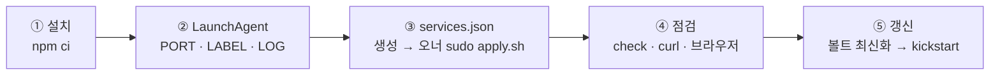

# 볼트 뷰어를 이름으로 — 처음부터 끝까지
<!-- origin: lemoncloud-io/knowledge@121d6640:projects/local-nginx-proxy/config/skills/local-nginx-proxy/references/vault-viewer.md -->

볼트 읽기 뷰어(`projects/knowledge-viewer/config/app`)를 상시 서비스로 띄우고 `http://<이름>.local`로 연다.
이 문서의 `vault.local`은 예시 이름이다. 이름은 각자 고른다. 포트는 볼트마다 다르다(§ 이 볼트의 값).

## 목차

- 이 볼트의 값
- 순서 한눈에
- ① 뷰어 앱 설치
- ② 상시 서비스(LaunchAgent)
- ③ 이름 추가와 적용
- ④ 점검
- ⑤ 갱신
- ⑥ AI 키 파일
- ⑦ 문제 해결
- 한 기기에 볼트가 여럿일 때

## 이 볼트의 값

먼저 네 값을 정한다. 아래 명령은 모두 이 변수를 쓴다. 같은 셸에서 차례로 돌린다.

| 변수 | 정하는 법 | 예(이 기기에 볼트가 하나) | 예(여럿 중 하나) |
| --- | --- | --- | --- |
| `PORT` | 그 볼트의 뷰어 README 나 `.claude/launch.json` 의 뷰어 항목에 적힌 포트. 없으면 기본 8778 | `8778` | `8782` |
| `NAME` | 각자 고른다. 소문자 DNS 라벨 하나 + `.local` | `vault.local` | `docs.local` |
| `LABEL` | 하나뿐이면 `local.knowledge-viewer.serve`. 여럿이면 `local.knowledge-viewer.<이름>.serve` | `local.knowledge-viewer.serve` | `local.knowledge-viewer.docs.serve` |
| `LOG` | 하나뿐이면 `serve.log`. 여럿이면 `serve-<이름>.log`. 폴더는 `~/.local/state/knowledge-viewer/` | `…/serve.log` | `…/serve-docs.log` |

- `<이름>`은 `NAME`의 첫 라벨이다(`docs.local` → `docs`).
- 뷰어는 주 포트와 git 포트(주 포트 + 1)를 함께 연다. 그래서 볼트끼리 포트를 둘씩 띄운다(예: 8780 · 8782 · 8784).

## 순서 한눈에



볼트 뷰어는 볼트 루트 하나만 낸다. 상시 서비스는 그 볼트의 주 체크아웃에서 띄운다. 따로 서빙 폴더를 만들지 않는다.

## ① 뷰어 앱 설치

볼트 루트에서 뷰어 유닛의 설치 명령을 그대로 돌린다(정본: `projects/knowledge-viewer/config/README.md` § 실행과 시험).

```sh
npm --prefix projects/project-viewer/config/shell ci
npm --prefix projects/knowledge-viewer/config/app ci
```

## ② 상시 서비스(LaunchAgent)

launchd 는 `~`를 풀지 않는다. 그래서 셸 변수로 절대 경로를 채운다. 볼트 루트에서 돌린다.
경로에 `&`·`<`가 있으면 plist 가 깨진다 — 그런 경로는 쓰지 않는다.
첫 네 줄은 § 이 볼트의 값으로 바꾼다.

```sh
PORT=8778                         # 이 볼트의 뷰어 포트
NAME=vault.local                  # 예시 이름 — 각자 고른 이름
LABEL=local.knowledge-viewer.serve
LOG="$HOME/.local/state/knowledge-viewer/serve.log"
VAULT="$(pwd -P)"                 # 볼트 주 체크아웃 루트
NODE="$(command -v node)"         # Node 24 이상
PLIST="$HOME/Library/LaunchAgents/$LABEL.plist"
mkdir -p "$(dirname "$LOG")" "$(dirname "$PLIST")"
cat > "$PLIST" <<EOF
<?xml version="1.0" encoding="UTF-8"?>
<!DOCTYPE plist PUBLIC "-//Apple//DTD PLIST 1.0//EN" "http://www.apple.com/DTDs/PropertyList-1.0.dtd">
<plist version="1.0">
<dict>
 <key>Label</key><string>$LABEL</string>
 <key>ProgramArguments</key>
 <array>
  <string>$NODE</string>
  <string>--env-file-if-exists=$HOME/.config/knowledge-viewer/env</string>
  <string>start.ts</string>
  <string>--vault</string><string>$VAULT</string>
  <string>--port</string><string>$PORT</string>
 </array>
 <key>WorkingDirectory</key><string>$VAULT/projects/knowledge-viewer/config/app</string>
 <key>EnvironmentVariables</key>
 <dict>
  <key>PATH</key><string>$(dirname "$NODE"):/opt/homebrew/bin:/usr/local/bin:/usr/bin:/bin:/usr/sbin:/sbin</string>
  <key>KNOWLEDGE_VIEWER_PUBLIC_HOSTS</key><string>$NAME</string>
 </dict>
 <key>RunAtLoad</key><true/>
 <key>KeepAlive</key><true/>
 <key>ThrottleInterval</key><integer>10</integer>
 <key>StandardOutPath</key><string>$LOG</string>
 <key>StandardErrorPath</key><string>$LOG</string>
</dict>
</plist>
EOF
plutil -lint "$PLIST"
launchctl bootstrap "gui/$(id -u)" "$PLIST"
```

- `PATH`에 node·npm 이 있어야 한다. `dist`가 낡았으면 기동 때 빌드하기 때문이다.
- `KNOWLEDGE_VIEWER_PUBLIC_HOSTS`가 이름을 허용한다. 없으면 그 이름은 `127.0.0.1`로 넘겨진다(§ ⑦).
- 확인: `curl -s -o /dev/null -w '%{http_code}' -H "Host: $NAME" "http://127.0.0.1:$PORT/"`가 200 이다.
- 기동 때 볼트 전체를 색인한다(수십 초). 주 포트와 git 포트(주 포트 + 1)를 함께 연다.

## ③ 이름 추가와 적용

1. `~/.config/local-nginx-proxy/services.json`의 `services`에 한 줄을 더한다. `port`는 `PORT`다.
   `{"name":"vault","port":8778,"app":"knowledge-viewer","title":"볼트 뷰어","open":"/"}`
   `app`이 `knowledge-viewer`여야 여는 스킬이 이 이름을 찾는다.
2. 생성: `node projects/local-nginx-proxy/config/local-nginx-proxy/render.mjs`.
3. 적용(오너): `sudo sh ~/.local/state/local-nginx-proxy/apply.sh`. 에이전트는 sudo 를 돌리지 않는다.

## ④ 점검

- `node projects/local-nginx-proxy/config/local-nginx-proxy/render.mjs check` — `daemon: running`, 그 이름의 `http`가 200.
- `curl -s -o /dev/null -w '%{http_code}' "http://$NAME/"` 가 200.
- 브라우저로 `http://<이름>.local/`을 연다. 주소 꼴은 뷰어 유닛 README 의 이름으로 열기 절을 본다.

## ⑤ 갱신

1. 볼트 주 체크아웃을 최신으로 맞춘다(기본 브랜치를 fast-forward).
2. `launchctl kickstart -k "gui/$(id -u)/$LABEL"`.
3. 기동 때 색인에 수십 초가 걸린다. `dist`가 낡았으면 기동 때 빌드한다. 그동안 이름은 502 를 낼 수 있다.

plist 를 바꿨으면 kickstart 대신 `launchctl bootout "gui/$(id -u)/$LABEL"` 뒤 다시 `bootstrap` 한다.

## ⑥ AI 키 파일

- 앱 플러그인의 AI 키는 `~/.config/knowledge-viewer/env`(소유자만 읽기, `chmod 600`)에 둔다. 값은 사람이 넣는다.
- 뷰어는 node `--env-file-if-exists`로 읽는다. 파일이 없으면 앱은 mock 으로 돈다.
- 변수 이름과 결정 문구의 정본은 뷰어 프로젝트 README § 앱 플러그인의 "AI 키" 항목이다(해당 문서가 있는 볼트에서만).
- 바꾼 뒤 § ⑤의 kickstart 로 다시 띄운다.

## ⑦ 문제 해결

| 증상 | 원인 | 할 일 |
| --- | --- | --- |
| 이름이 502 | 뷰어 서비스가 안 떴다(또는 색인 중) | `launchctl print "gui/$(id -u)/$LABEL"`, `$LOG`를 본다 |
| 403, 또는 `127.0.0.1`로 넘어감 | `KNOWLEDGE_VIEWER_PUBLIC_HOSTS`에 그 이름이 없다 | plist 환경에 넣고 bootout → bootstrap |
| 재부팅 뒤 로그인 전 502 | LaunchAgent 는 로그인 때 뜬다 | 로그인 뒤 다시 본다 |
| 이름이 안 풀림 | hosts 블록이 없다 | `render.mjs check`, 오너가 `apply.sh` |
| 서비스가 거듭 다시 뜸, 로그에 포트 사용 중(`EADDRINUSE`) | 다른 볼트의 뷰어가 같은 `PORT`나 `PORT + 1`을 쓴다 | § 한 기기에 볼트가 여럿일 때 — 포트를 둘씩 띄운다 |

- 뷰어 로그: `$LOG`(기본 `~/.local/state/knowledge-viewer/serve.log`).
- 프록시 로그: `~/.local/state/local-nginx-proxy/nginx/logs/`.

## 한 기기에 볼트가 여럿일 때

볼트 뷰어 하나는 볼트 하나만 낸다. 볼트마다 ①~④를 따로 한 번씩 한다. 볼트마다 다섯 가지가 달라야 한다.

1. **포트.** 그 볼트의 뷰어 포트를 쓴다. git 포트(주 포트 + 1)까지 겹치지 않게 둘씩 띄운다(예: 8780 · 8782 · 8784).
2. **이름.** 볼트마다 다른 이름을 고른다. `KNOWLEDGE_VIEWER_PUBLIC_HOSTS`에는 그 볼트의 이름만 넣는다.
3. **LaunchAgent 라벨.** `local.knowledge-viewer.<이름>.serve`. 같은 라벨로 두 번 올리면 plist 를 덮어쓴다.
   이미 `local.knowledge-viewer.serve`로 설치한 볼트는 그대로 둬도 된다. 그 라벨은 한 볼트만 쓴다.
4. **로그 파일.** `~/.local/state/knowledge-viewer/serve-<이름>.log`. 기존 `serve.log`는 그 라벨의 볼트가 계속 쓴다.
5. **`services.json`.** 볼트마다 한 줄이다. `app`은 모두 `knowledge-viewer`다. `port`만 볼트마다 다르다.
   ```json
   {"name":"vault","port":8780,"app":"knowledge-viewer","title":"볼트 뷰어"},
   {"name":"docs","port":8782,"app":"knowledge-viewer","title":"문서 볼트 뷰어"}
   ```

여는 스킬은 이름을 고르지 않는다. 생성기 `url`이 응답한 이름을 모두 `candidates`로 준다(목록 순서).
스킬은 그 후보를 차례로 `same-vault.ts`로 견준다. 세션의 볼트 루트를 내는 첫 이름으로 연다.

AI 키 파일은 기기에 하나다. 앱에는 볼트별 키 설정이 없다. 키는 plist 의 node 옵션
`--env-file-if-exists`가 읽고, 위 템플릿은 볼트마다 같은 `~/.config/knowledge-viewer/env`를 가리킨다.
그래서 템플릿대로 올린 볼트 뷰어는 모두 같은 키를 쓴다.
